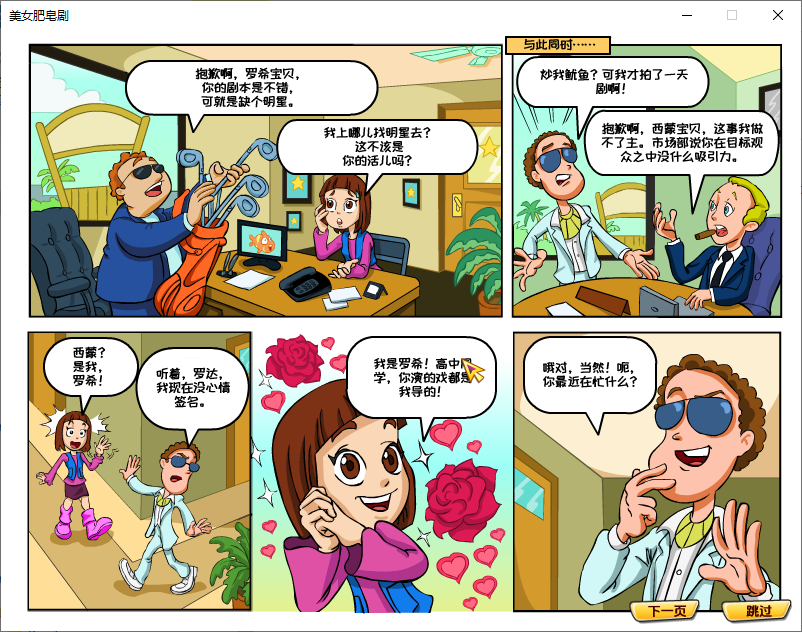
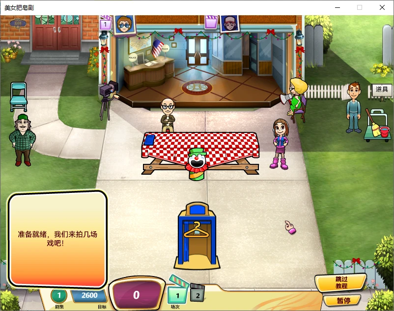

# 美女肥皂剧 · Soap Opera Dash 中文汉化

PlayFirst 2010 年的经营游戏 *Soap Opera Dash*（《美女餐厅》Diner Dash 系列外传）的爱好者中文汉化补丁。

- 全部游戏文本：界面、帮助、教程、剧情漫画、关卡台词、道具说明、成就等，共 1122 条
- 四套中文字体，字号、行距按原版对齐，中文自动换行、标点避头尾
- 重新设计的中文标志《美女肥皂剧》
- 剧情漫画中文显示（原版 Flash 动画无法显示中文，改为静态图加文字）

| 主菜单 | 剧情漫画 | 游戏中 |
|---|---|---|
|  |  |  |

## 下载与安装

到 [Releases](https://github.com/Aden-c/SoapOperaDashCN/releases) 下载最新的 `SoapOperaDashCN_vX.X.zip`。

1. 把压缩包里的全部内容解压到游戏目录（`Soap Opera Dash.exe` 所在的文件夹）
2. 双击 `安装汉化.bat`，原版文件会自动备份到 `cn_backup`
3. 运行游戏

想恢复英文版，双击 `卸载汉化.bat`。

### 适用版本

- 测试版本 1.0.1.128，游戏资源为**散文件**（游戏目录下有 `assets` 文件夹）。
- 如果你的游戏目录里只有 `assets.pfp` 封包、没有 `assets` 文件夹，需要先解包。此情况尚未实测，欢迎反馈。

## 制作人员

| 工作 | 成员 |
|---|---|
| 审校、中文标志设计、解包 | 艾登 |
| 初译、图片处理、字体与排版技术 | Claude Opus 5.5 |

## 字体

| 用途 | 字体 | 授权 |
|---|---|---|
| 正文 | HarmonyOS Sans SC | 华为授权，仅嵌入本补丁使用，请勿提取另作他用 |
| 标题 | 寒蝉团圆体（圆体） | SIL OFL 1.1 |
| 按钮、数字 | 金字社真好体 | SIL OFL 1.1（按钮的英文和数字保留原版字形） |
| 漫画对白 | 站酷快乐体 | SIL OFL 1.1 |
| 标志 | 江城解星体、霞鹜漫黑 | 仅用于标志图片 |

各字体的授权全文随补丁附在 `字体授权` 文件夹中。

## 仓库内容

本仓库只包含汉化成果和工具，**不含任何游戏原版资源**。

```
zh.json            全部译文（key → 中文），翻译的唯一来源
charset.txt        字体字符集
fonts.json         本游戏的字体配置
fonttool/          通用 PlayFirst 字体工具：TTF/OTF → .mvec，可用于其他 PlayFirst 游戏（见其 README）
strings_tool.py    把译文写回游戏 strings.xml（自动插入中文折行点）
proofread.py       导出 / 导入 Excel 校对表
fitcheck.py        按字体度量估算文字是否放得下
credits_tool.py    生成制作人员名单
logo/              标志：去字、贴回图集的脚本，以及中文标志成品
make_patch.py      打包发布用的补丁
```

### 自己构建

需要 Python 3.10+，以及 `pip install -r fonttool/requirements.txt openpyxl`。

工具默认的目录结构是：本仓库与游戏的 `Game Files` 文件夹放在同一层，原版文件放在仓库的 `backup/` 里（不上传）：

```
某目录/
├─ Game Files/            游戏（资源为散文件）
└─ SoapOperaDashCN/       本仓库
   └─ backup/             原版 strings.xml、字体、脚本、图片的备份（自行从游戏复制）
```

```
python strings_tool.py export     从 backup/strings.xml 导出原文 en.json
python strings_tool.py apply      把 zh.json 写进游戏
sh build_fonts.sh                 生成并安装全部字体
python credits_tool.py            生成制作人员名单
python make_patch.py 1.0          打包补丁到 dist/
```

## 技术要点

- PlayFirst Playground 引擎的 `.mvec` 字体格式（MVC4）已完全解析，见 [fonttool/README.md](fonttool/README.md)。
- 引擎对无空格的中文会“超出边界后才折行”。对策是字体里空格设为零宽，写入译文时在中文字之间插入空格作为折行点。
- 游戏优先用 Flash 播放漫画；移走 swf 后会退回“PNG + XML 文字框”模式，用游戏自己的字体显示中文。

## 声明

本项目为爱好者汉化，与 PlayFirst、Bamtang 及其关联公司无关。*Soap Opera Dash*、*Diner Dash*、PlayFirst 均为其各自所有者的商标。
请使用自己合法拥有的游戏副本。

## 授权

| 内容 | 授权 |
|---|---|
| 工具代码（`*.py`、`fonttool/` 等） | [MIT](LICENSE) |
| 译文（`zh.json`）、中文标志设计（`logo/logo_cn.png`） | [CC BY-NC 4.0](https://creativecommons.org/licenses/by-nc/4.0/deed.zh-hans)：可转载、修改，须署名，不得用于商业用途 |
| 字体 | 各自的授权，见上方“字体”一节 |

游戏原版内容的版权归 PlayFirst / Bamtang 所有，不在上述授权范围内。
